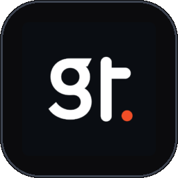
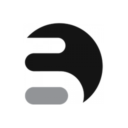
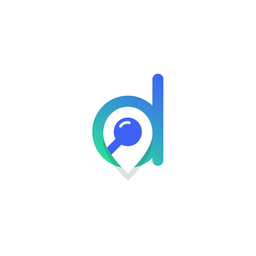

<!-- ═══════════════════════════ HERO ═══════════════════════════ -->
<div align="center">


<a href="https://github.com/Arafat-plugins">
  
</a>

<br/><br/>

<h3>&nbsp; Core Expertise</h3>

<a href="#"></a>
<a href="#"></a>
<a href="#"></a>

<a href="#"></a>
<a href="#"></a>

<h3>&nbsp; AI-Assisted Engineering</h3>

<a href="#"></a>
<a href="#"></a>
<a href="#"></a>

<br/>

<table>
  <tr>
    <td align="center" width="640">
      &nbsp; <b>Currently learning</b><br/>
      <a href="https://karpathy.ai/zero-to-hero.html"><b>Neural Networks: Zero to Hero</b></a> by Andrej Karpathy<br/>
      <sub>Building LLMs from scratch — backprop, makemore, GPT, tokenizers</sub>
    </td>
  </tr>
</table>

<br/>

<h3>&nbsp; Professional Journey</h3>

<a href="#"></a>
<a href="#"></a>
<a href="#"></a>

<br/><br/>

<table>
  <tr>
    <td width="72" align="center" valign="top">
      <a href="https://goodtechies.com"></a>
    </td>
    <td width="568" valign="top">
      <h3>GoodTechies &nbsp;<sub><code>Current</code></sub></h3>
      &nbsp; <b>Custom ERP — built end to end</b><br/>
      <sub>An all-in-one company workspace where every part of the business is handled in one place.</sub>
      <br/><br/>
      &nbsp; <b>Messenger</b> — real-time team chat<br/>
      &nbsp; <b>Meetings</b> — schedule and run team meetings<br/>
      &nbsp; <b>Voice Messages</b> — record and send voice notes<br/>
      &nbsp; <b>Attendance</b> — daily attendance tracking<br/>
      &nbsp; <b>Clients</b> — client records and communication<br/>
      &nbsp; <b>Projects</b> — full project management<br/>
      &nbsp; <b>Tasks</b> — assign, track and complete tasks
      <br/><br/>
      &nbsp; <b>PDF Generator</b> — custom PDF generation tool built in-house
    </td>
  </tr>
  <tr>
    <td width="72" align="center" valign="top">
      <a href="https://sovware.com"></a>
    </td>
    <td width="568" valign="top">
      <h3>Sovware</h3>
      &nbsp; <b>900+ website issues fixed</b> — bugs, conflicts, layout and performance problems on live client sites<br/>
      &nbsp; <b>WPML</b> — multilingual WordPress sites, translation setup and compatibility fixes<br/>
      &nbsp; <b>Directorist</b> — core plugin, <b>extensions</b> and <b>themes</b>: development, customization and support
    </td>
  </tr>
</table>

</div>


## Tech Stack


## About

Full stack developer and LLM engineer currently working at **GoodTechies**, where I built a complete company **ERP** (messenger, meetings, voice messages, attendance, clients, projects and tasks) and a custom **PDF generator**.

Previously at **Sovware**, I fixed **900+ website issues** and worked across **WPML** multilingual sites and the **Directorist** plugin, its extensions and themes.

## Technologies Used

- **PHP** - Server-side scripting language
- **LLM** - Large language model engineering — building and training models from scratch (Andrej Karpathy's *Zero to Hero*)
- **ERP** - Built a full company ERP: messenger, meetings, voice messages, attendance, clients, projects and tasks
- **Android apps** - Native and cross-platform Android application development
- **Full stack web developer** - End-to-end web apps, from database and APIs to frontend UI
- **MySQL** - Relational database management system
- **JavaScript** - Client-side programming language
- **CSS3** - Styling language
- **HTML5** - Markup language
- **WordPress** - Content management system
- **WPML** - Multilingual WordPress sites, translation setup and compatibility fixes
- **Directorist** - Directory plugin development, including its extensions and themes
- **PDF generator** - Custom PDF generation tooling
- **WordPress debugger** - Troubleshooting WordPress issues and tracking down plugin or theme conflicts
- **Elementor** - Page builder for WordPress
- **Linux** - Operating system
- **macOS** - Operating system
- **jQuery** - JavaScript library
- **AI** - Artificial Intelligence
- **OpenClaw** - Custom automation and integration tooling
- **n8n** - Workflow automation platform
- **Automation engineer** - Process automation, integrations, and workflow optimization
- **Automation software creator** - Designing and shipping custom automation software end to end
- **Claude expert** - Building with Claude and Claude Code for production-grade development
- **Codex expert** - AI pair-programming and code generation with OpenAI Codex
- **Vibe coding expert** - Rapid, AI-first prototyping from idea to working product
- **localhost** - Local development and testing environment
- **MCP server** - Model Context Protocol server integrations
- **VPS server expert** - Virtual private server deployment and management

## Installation

```bash
# Clone the repository
git clone https://github.com/yourusername/Arafat-plugins.git

# Navigate to the directory
cd Arafat-plugins
```

## Usage

Install and activate the plugin through WordPress admin panel.

## Contributing

Contributions are welcome! Please feel free to submit a Pull Request.

## License

This project is open source and available under the [MIT License](LICENSE).


