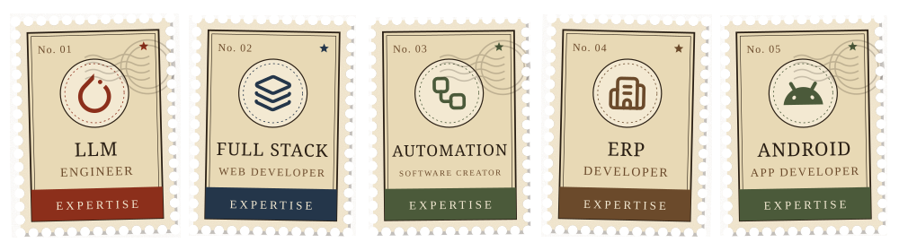
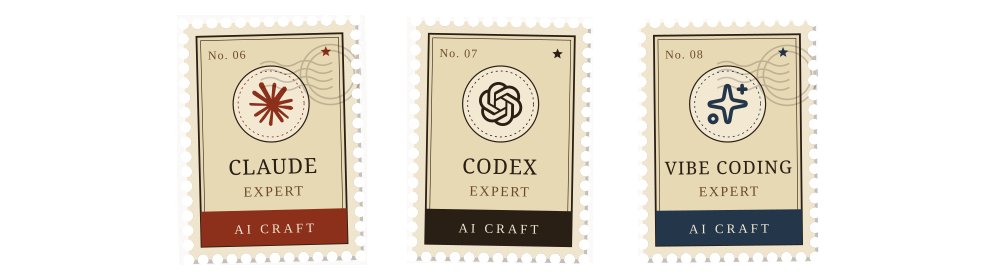
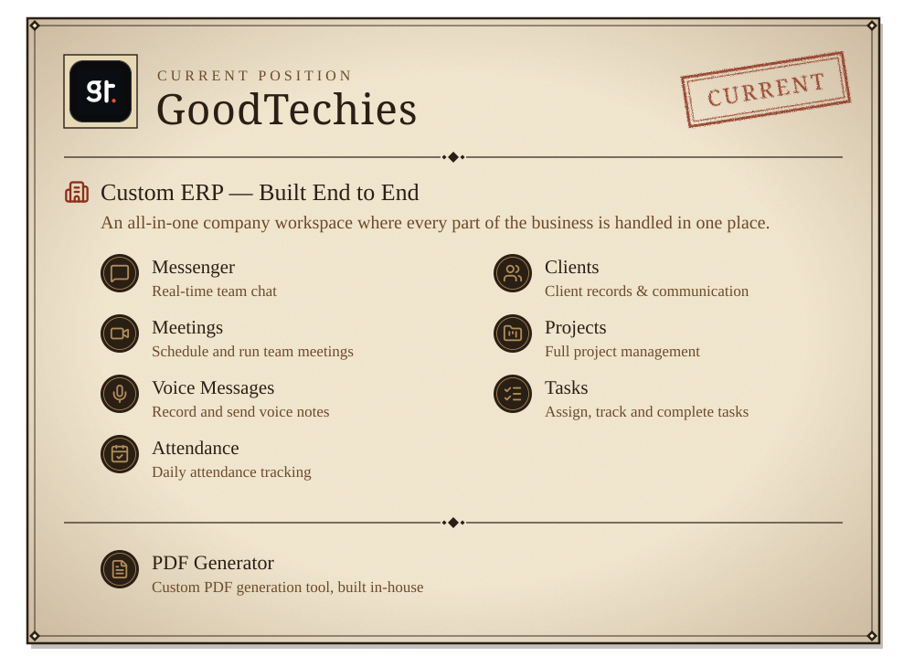
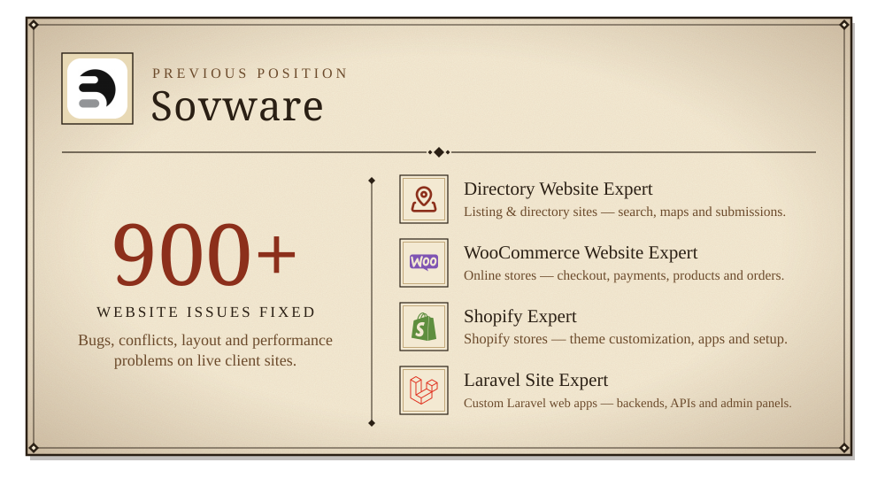
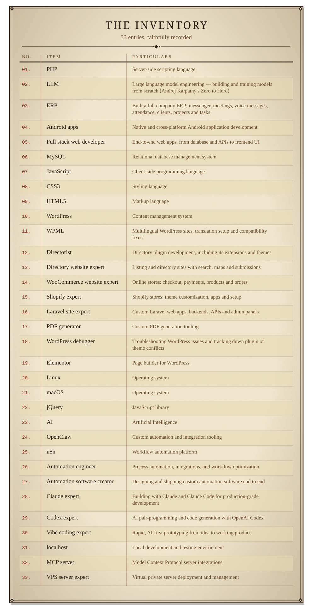
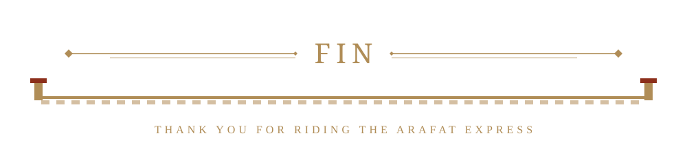

<div align="center">



<br/>


<br/>

<p>
<i>Full stack developer and LLM engineer, currently at</i> <b>GoodTechies</b>, <i>where I built a complete company</i> <b>ERP</b> <i>— messenger, meetings, voice messages, attendance, clients, projects and tasks — and a custom</i> <b>PDF generator</b>.
</p>

<p>
<i>Previously at</i> <b>Sovware</b>: <b>900+ website issues fixed</b>, <i>working as a</i> <b>directory website</b>, <b>WooCommerce</b>, <b>Shopify</b> <i>and</i> <b>Laravel</b> <i>site expert.</i>
</p>

<br/>




<br/>




<br/>


<a href="https://karpathy.ai/zero-to-hero.html"></a>

<br/>


<a href="https://goodtechies.com"></a>

<a href="https://sovware.com"></a>

<br/>


<br/>


<br/>


</div>

<br/>

<div align="center">



</div>

<details>
<summary><i>Plain-text inventory</i></summary>

<br/>

- **PHP** - Server-side scripting language
- **LLM** - Large language model engineering — building and training models from scratch (Andrej Karpathy's *Zero to Hero*)
- **ERP** - Built a full company ERP: messenger, meetings, voice messages, attendance, clients, projects and tasks
- **Android apps** - Native and cross-platform Android application development
- **Full stack web developer** - End-to-end web apps, from database and APIs to frontend UI
- **MySQL** - Relational database management system
- **JavaScript** - Client-side programming language
- **CSS3** - Styling language
- **HTML5** - Markup language
- **WordPress** - Content management system
- **WPML** - Multilingual WordPress sites, translation setup and compatibility fixes
- **Directorist** - Directory plugin development, including its extensions and themes
- **Directory website expert** - Listing and directory sites with search, maps and submissions
- **WooCommerce website expert** - Online stores: checkout, payments, products and orders
- **Shopify expert** - Shopify stores: theme customization, apps and setup
- **Laravel site expert** - Custom Laravel web apps, backends, APIs and admin panels
- **PDF generator** - Custom PDF generation tooling
- **WordPress debugger** - Troubleshooting WordPress issues and tracking down plugin or theme conflicts
- **Elementor** - Page builder for WordPress
- **Linux** - Operating system
- **macOS** - Operating system
- **jQuery** - JavaScript library
- **AI** - Artificial Intelligence
- **OpenClaw** - Custom automation and integration tooling
- **n8n** - Workflow automation platform
- **Automation engineer** - Process automation, integrations, and workflow optimization
- **Automation software creator** - Designing and shipping custom automation software end to end
- **Claude expert** - Building with Claude and Claude Code for production-grade development
- **Codex expert** - AI pair-programming and code generation with OpenAI Codex
- **Vibe coding expert** - Rapid, AI-first prototyping from idea to working product
- **localhost** - Local development and testing environment
- **MCP server** - Model Context Protocol server integrations
- **VPS server expert** - Virtual private server deployment and management

</details>

<br/>

<div align="center">


</div>

<br/>

### Installation

```bash
# Clone the repository
git clone https://github.com/Arafat-plugins/Arafat-plugins.git

# Navigate to the directory
cd Arafat-plugins
```

### Usage

Install and activate the plugin through WordPress admin panel.

### Contributing

Contributions are welcome! Please feel free to submit a Pull Request.

### License

This project is open source and available under the [MIT License](LICENSE).

<br/>

<div align="center">



</div>
